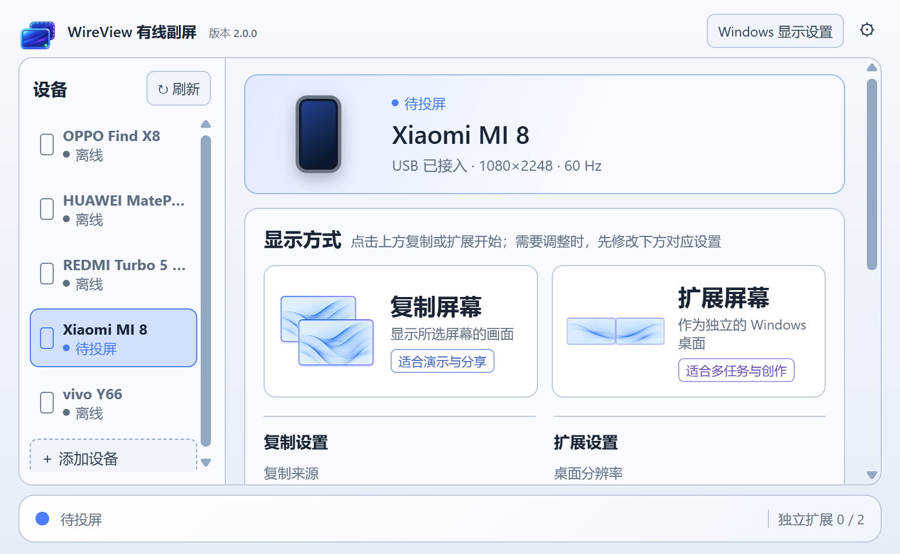
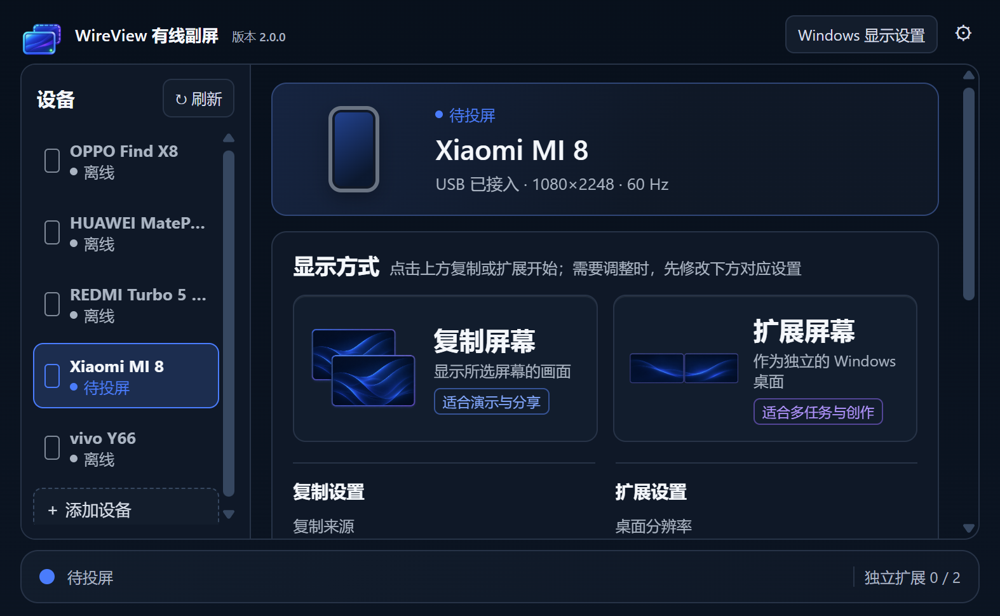

# WireView 有线副屏

**让闲置的 Android 手机和平板，成为 Windows 的第二块屏幕。**

WireView 通过 USB 数据线把电脑画面传到 Android 设备：既能复制已有屏幕进行演示，也能创建独立扩展桌面，把文档、聊天窗口、代码参考或绘画工具放到副屏上。支持的设备还可以把触控和手写笔操作传回电脑。

视频在电脑与设备之间通过 USB 传输，不依赖 Wi-Fi 或投屏云服务，也不要求手机支持 USB-C DP 视频输出。

[下载安装包](https://github.com/liujiaxing060903/WireView/releases) · [第一次使用](docs/RELEASE_WINDOWS.md) · [2.0.2 更新说明](docs/releases/v2.0.2.md) · [反馈问题](https://github.com/liujiaxing060903/WireView/issues)

## 2.0.2：浅色设备图标与更新提示

设备卡片中的手机、平板图标在浅色模式使用浅蓝屏面、浅色边框和柔和阴影。更新入口收在「关于 WireView」标题右侧，平时不额外占行；有新版时弹出 GitHub 和网盘下载选择，电脑端点击网盘会自动复制密码。

控制中心与安卓接收端在启动和运行中每6小时自动检查，控制中心另提供手动检查。安卓仅发现新版时显示下载入口，无需更新时保持原界面。发现新版后可选择 [GitHub](https://github.com/liujiaxing060903/WireView/releases/latest) 或 [网盘](https://wwbkc.lanzoue.com/b01euxnp0d) 下载，网盘密码 `df73`。安卓使用关闭调试的 Release 构建，沿用旧证书，可保留数据覆盖升级。

2.0.0及更早版本需要先手动升级到2.0.2，之后才能收到更新提示。

## 在一个控制中心管理你的副屏

- **复制和扩展，点一下开始。** 不调参数时直接使用该设备保存的设置；需要调整时，先改下方参数，再点上方对应卡片。
- **笔记本合盖，手机和平板继续显示。** 复制与扩展均有真实合盖、开盖验证。先设置 Windows 合盖不睡眠；合盖复制还需 Parsec VDD 和支持的显示配置，详见下方说明。
- **设备集中管理，操作彼此独立。** 多台手机和平板可以同时连接，分别启动、停止；最多创建两块独立扩展屏。
- **托盘也能操作。** 右键托盘图标，悬停某台已连接设备，即可复制、扩展或只停止这一台。
- **投屏后直接看屏幕位置。** 设置区切换为屏幕排布，支持标识屏幕，并可打开 Windows 设置调整位置。
- **参数按设备记住。** 复制来源、扩展分辨率、帧率、输入方式和鼠标大小分别保留，常用扩展尺寸优先显示。
- **浅色和深色都适配。** 两种主题各有合适的图标配色，高级设置可折叠收起。

查看深色控制中心

## 可以拿它做什么

| 使用场景 | 适合的方式 |
| --- | --- |
| 给身边的人演示电脑内容 | 复制屏幕 |
| 合上笔记本，在手机或平板上继续使用电脑 | 合盖复制（需 Parsec VDD 和支持的显示配置）或扩展 |
| 一边写代码，一边查文档或看运行结果 | 扩展屏幕 |
| 把聊天、音乐和参考资料从主屏移开 | 扩展屏幕 |
| 用支持的平板触控或手写笔操作 Windows 应用 | 开始前选择「触控与手写笔」 |

默认「仅显示」适合把设备当普通副屏。开启输入后可回传多点触控，以及设备提供的笔压、倾角和橡皮擦事件；具体能力取决于设备、手写笔及 Windows 应用。

## 需要准备什么

- Windows 10 / Windows 11 x64 电脑。
- Android 6.0 及以上的手机或平板；已在 vivo Y66（Android 6.0.1）和小米 8（Android 10）上使用 2.0.0 真机验证复制和扩展。
- 支持数据传输的 USB 线，Android 端开启 USB 调试并授权电脑。
- Windows 端安装 [WebView2 Evergreen Runtime](https://developer.microsoft.com/microsoft-edge/webview2/)，并准备官方完整的 [Android SDK Platform Tools](https://developer.android.google.cn/tools/releases/platform-tools?hl=zh-cn)。
- 使用扩展桌面时，另行安装 [Parsec Virtual Display Driver](https://github.com/nomi-san/parsec-vdd)。普通复制不要求安装这个驱动。

Windows 包不捆绑 Platform Tools 或第三方驱动安装器，包内的「安装依赖」文件夹提供获取说明。

## 五步开始

1. 从同一版本的 Release 下载 Windows ZIP 和 Android APK。完整解压 Windows 包，在手机或平板上安装并打开 WireView。
2. 把官方压缩包中的**整个 `platform-tools` 文件夹**放到 Windows 程序旁边，确保存在 `platform-tools/adb.exe` 及其配套文件。
3. 用数据线连接设备，解锁屏幕，在 Android 上允许这台电脑进行 USB 调试。
4. 打开 `WireView 控制中心.exe`，从左侧选择设备。复制可选择来源屏幕，扩展可调整桌面分辨率、帧率和自定义尺寸；这些设置会按设备保留。
5. 点击上方「复制屏幕」或「扩展屏幕」。结束时点击该设备的「停止投屏」，也可从托盘子菜单停止。

复制和扩展之间切换，或更改输入方式、分辨率等启动参数时，先停止当前设备。投屏中会用屏幕排布替换设置区；停止后设置区恢复。

右上角 X 隐藏控制中心，画面继续传输；从托盘可重新显示或操作设备。「退出 WireView」才会关闭电脑端及其会话。

## 相比上一公开版 1.1.20

| 方面 | 2.0.0 的变化 |
| --- | --- |
| 设备管理 | 从单台会话发展为统一设备列表，支持多台设备独立启动、停止和扩展 |
| 操作入口 | 复制与扩展的设置分开，上方卡片直接启动，托盘也可按设备操作 |
| 屏幕位置 | 投屏中显示排布，提供左下角大编号标识和调整位置入口 |
| 合盖使用 | 增加合盖复制，保留合盖扩展；符合显示配置和电源设置条件时，合盖后设备继续显示 |
| 鼠标显示 | 修复部分设备鼠标偏小的问题，支持每台设备单独设置 50%～300% 大小 |
| 连接与恢复 | 修复拔插、旋转、停止后重开及控制中心重新显示时的多项状态问题 |
| Android 接收端 | 增加 Android 10 兼容处理；投屏中隐藏旋转按钮，停止后恢复 |
| 界面 | 更新模式图标、浅深配色、设置分组和展开按钮，减少重复入口 |

完整变更、升级方式和验证范围见 [2.0.0 更新说明](docs/releases/v2.0.0.md)。

## 常见问题

**笔记本合盖后，手机或平板还能显示吗？**

可以。先在 Windows 电源设置中把「盖上盖子」设为「不执行任何操作」，让电脑保持运行。合盖复制需要安装 Parsec VDD；在仅启用笔记本内屏、驱动能建立匹配复制桌面时，WireView 会自动准备对应屏幕，合盖后设备继续显示，开盖后恢复复制桌面。这一路径已有真实合盖、开盖验证。

已有其他活动显示器或无法建立复制配对时，程序使用普通复制，不能保证合盖后继续显示。扩展模式也已通过合盖、开盖测试，步骤见 [使用说明](docs/RELEASE_WINDOWS.md#合盖后继续使用)。

**复制时，为什么 Windows 设置中可能没有新增显示器？**

普通复制直接采集已有屏幕并发送到设备；扩展才需要独立桌面。在部分单笔记本内屏的合盖复制场景下，程序会尝试建立配对副屏，具体说明见使用指南。

**复制设置里的分辨率和帧率，会改变电脑屏幕吗？**

这两项限制发送视频的尺寸和帧率，画面按比例处理；来源屏幕本身的显示参数仍由 Windows 管理。扩展设置中的分辨率则是新桌面的尺寸。

**可以同时让两台设备复制同一个来源吗？**

当前同一个复制来源只允许一台设备使用。可以选不同来源，或让另一台设备使用独立扩展；最多同时建立两块 WireView 扩展屏。

**120 帧已经稳定了吗？**

60 FPS 是常用档位。120 FPS 仍为实验性编码与发送目标，实际显示效果受电脑、解码器、设备刷新率及分辨率影响，不能把电脑发送帧率当作设备最终显示帧率。

**目前还不支持什么？**

暂不支持音频、Wi-Fi／远程连接、Windows 登录前显示及 HDR／10-bit 桌面。编码器和虚拟显示驱动的兼容性仍取决于具体电脑；出现问题可先尝试 SDR、较低分辨率和 60 FPS。

## 升级和反馈

建议电脑端和 Android 端一起更新。Android 包沿用 1.1.20 的侧载签名，可保留数据覆盖安装；Windows 使用完整的新文件夹，设备设置保存在用户目录中。

反馈时请说明 Windows 版本、显卡、Android 机型、使用分辨率与帧率，以及复现步骤。控制中心的「连接诊断」可查看对应设备状态和日志。

开发者可阅读 [构建与调试资料](docs/DEVELOPMENT.md)。当前产品使用 Windows 桌面捕获与 H.264 编码、Android MediaCodec 解码；扩展桌面依赖外部 Parsec VDD。
